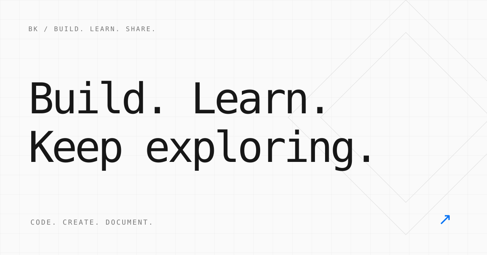

> **建站示例文章**：本文用于演示博客排版与写作方式，可直接修改或删除，不代表既往项目经历。

## 为什么从记录开始

一个个人网站，可以是作品的入口，也可以是一张不断生长的笔记。这里把项目与文章放在一起：展示已经做出来的东西，也给尚在探索中的想法留一点位置。

不必等到所有事情都想清楚，先从一段代码、一份笔记开始。



## 这个网站如何工作

网站使用 **Astro** 生成静态页面。文章以 Markdown 保存在仓库中，推送更新后，GitHub Actions 完成构建，再部署到 GitHub Pages。

```text
写下 Markdown → 推送到 GitHub → 自动构建 → 发布网站
```

访客打开页面时，不需要等待服务器查询数据库，也不用登录。

### 项目与文章各司其职

- **项目**：集中展示开源仓库、用途和源码入口。
- **博客**：记录技术笔记、问题解决过程与想法。
- **关于**：放个人介绍和公开联系方式。

## 写下第一篇 Markdown

在 `src/content/blog/` 下新增一个 `.md` 文件，例如 `my-first-note.md`。文件名会成为文章地址的一部分，建议使用英文与短横线。

```yaml
---
title: '我的第一篇笔记'
description: '用一句话介绍这篇文章。'
pubDate: 2026-10-29
tags: ['笔记']
draft: false
---
```

正文支持标题、列表、引用、图片、表格和代码块。文章目录会根据二级、三级标题自动生成。

### 给代码一点上下文

代码块标记语言后，会自动显示语法高亮：

```typescript
const note = {
  title: '从一个小想法开始',
  published: true,
};

function keepExploring(idea: string): string {
  return `Build something with ${idea}.`;
}

console.log(keepExploring(note.title));
```

| 内容 | 维护方式 |
| --- | --- |
| 个人资料 | 编辑集中配置 |
| 项目介绍 | 更新项目列表 |
| 博客文章 | 新增 Markdown 文件 |

### 在本地预览与发布

首次运行先安装依赖，再启动开发服务器：

```sh
npm ci
npm run dev
```

在浏览器打开 `http://127.0.0.1:4321/`。修改 Markdown 后，可以直接查看更新效果。提交之前，运行检查、构建和内容测试：

```sh
npm run check
npm run build
npm test
```

把修改推送到 `main` 分支，GitHub Actions 就会自动发布。构建成功后，可在 [网站首页](https://binbinku.github.io/) 查看最新内容。

## 下一次更新

写作时可以先设置 `draft: true`。草稿不会出现在正式网站、标签列表或 sitemap 中；准备好后改为 `false`，再提交发布。

让每一篇文章解决一个小问题，让每一个项目向前走一步。保持好奇，持续构建。
